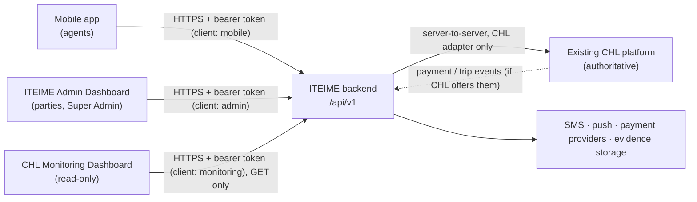

# How the apps communicate

How the **JRB CHL Enforcement mobile app**, the **ITEIME Admin Dashboard** and
the **CHL Monitoring Dashboard** exchange data, and what each one must send and
receive. Written for the backend developer and the three client teams.

It follows the backend's own architecture documents in `backend/docs/`
(system context, data ownership, API boundaries, ADR-0004, 0006, 0008, 0009,
0010) and checks the CHL Monitoring Dashboard's contract
([`chl_monitoring_dashboard/API_ENDPOINTS.md`](chl_monitoring_dashboard/API_ENDPOINTS.md))
against them. Where the two disagree, [section 6](#6-chl-monitoring-dashboard-against-the-backend)
lists each difference and what to agree.

**Status (12 Nov 2026):** the backend has finished Phase 3 (sign-in, refresh,
sign-out, forgot password, `/me`, authorization, audit trail, the CHL
boundary). No enforcement workflow, monitoring read endpoint (other than the
audit trail) or ITEIME Admin endpoint is implemented yet. CHL is simulated:
its API contract has not been received.

## In short

**Mobile app → Backend → ITEIME Admin Dashboard and CHL Monitoring Dashboard.**

1. The **mobile app** sends what agents do in the field (trip checks, GPS,
   penalties, evidence, field reports, SOS, offline actions) to the
   **backend**.
2. The **backend** stores it and, where needed, checks with **CHL** (trips,
   vehicles, payments). It is the only part that talks to CHL.
3. Both dashboards get that data **from the backend**:
   - the **ITEIME Admin Dashboard** shows it as enforcement actions,
     penalties, cases and the live feed, and **sends back** its own work
     (cases, transfers, legal decisions, teams);
   - the **CHL Monitoring Dashboard** shows it as verifications, trips,
     violations, evidence and payments, and **only reads**.

The dashboards ask the backend for data (page loads, a refresh every minute,
and later a live feed); the backend does not push into them. The apps never
talk to each other directly.

## Contents

1. [The systems](#1-the-systems)
2. [The one rule: everything goes through the backend](#2-the-one-rule-everything-goes-through-the-backend)
3. [Who owns which data](#3-who-owns-which-data)
4. [How data moves between the apps](#4-how-data-moves-between-the-apps)
5. [Contract for each client](#5-contract-for-each-client)
6. [CHL Monitoring Dashboard against the backend](#6-chl-monitoring-dashboard-against-the-backend)
7. [ITEIME Admin Dashboard: what the backend needs to add](#7-iteime-admin-dashboard-what-the-backend-needs-to-add)
8. [Rules every client and the backend keep](#8-rules-every-client-and-the-backend-keep)
9. [Open questions](#9-open-questions)

## 1. The systems

| System | Folder | Users | Reads | Writes |
|---|---|---|---|---|
| **JRB CHL Enforcement app** (Flutter) | `jbr_chl_enforcement/` | Enforcement agents only | Verification results, its own history and notifications, payment status | Verifications, GPS, evidence, violations, demand-notice requests, field reports, SOS, loaded/empty, offline queue; transaction validation (ITEIME addendum) |
| **ITEIME Admin Dashboard** (React, being designed) | `iteime_admin_dashboard/` | Control Center, State IRS, Law Enforcement, Central Enforcement, Command & Control, Legal, Finance / Treasury, Intelligence, Agency Head, Super Admin | Cases, actions, penalties, transactions, teams, intelligence, audit | Cases, routing and transfers, notes, legal decisions, refunds, teams, users and permissions (Super Admin) |
| **CHL Monitoring Dashboard** (React, built) | `chl_monitoring_dashboard/` | System Administrator, Supervisor, Principal Officer | Verifications, trips, violations, evidence, payments, field reports, alerts, history, audit, sync status | **Nothing** (read-only); only sign-in, sign-out, marking its own notifications read and a sign-in support request |
| **ITEIME backend** (Node, Express, PostgreSQL) | `../backend/` | The three apps | — | The only backend (ADR-0004) |
| **Existing JRB CHL platform** | external | — | — | Authoritative for identity, vehicles, tags, trips, tariffs and payments |

## 2. The one rule: everything goes through the backend

- The three apps **never call each other** and **never call CHL**. They share
  data only through the backend.
- Each app signs in to its **own client surface**. A mobile session cannot call
  monitoring or admin routes, and the other way round (backend
  `requireClient`).
- The backend talks to CHL **only through its CHL adapter** (ADR-0006). If CHL
  is down, the backend answers "unavailable"; it never invents a result.

## 3. Who owns which data

From `backend/docs/architecture/data-ownership.md`. **CHL-owned data is never
computed or changed by ITEIME**; the backend stores a reference and, where
needed, a time-stamped snapshot of what was shown.

| Data | Owner | Created by | Shown in |
|---|---|---|---|
| Users, roles, agents, organizations | CHL | CHL administration | All three (profile, filters) |
| Vehicles, E-Tags, RFID / QR references | CHL | CHL | Mobile (after a check), Monitoring |
| CHL trips and trip validity | CHL | CHL | Mobile, Monitoring, Admin (enforcement actions) |
| Payments and transactions | CHL / payment providers | Providers | Mobile (status), Monitoring, Admin (Payments) |
| Verification attempts (with GPS) | ITEIME (proposed) | Mobile app | Mobile (own), Monitoring, Admin (enforcement actions) |
| Violations, evidence, demand notices | Undecided (CHL or ITEIME) | Mobile app | Mobile, Monitoring, Admin (penalties, case evidence) |
| Field reports, SOS, loaded/empty | ITEIME (proposed) | Mobile app | Monitoring, Admin (live feed) |
| Repeat-vehicle alerts | ITEIME (proposed) | The backend | Monitoring, Admin |
| Cases, actors, routing, transfers, linked cases | ITEIME | Admin Dashboard (Control Center; parties) | Admin; Mobile only if a case is linked to an agent's action |
| Legal notes, prosecution flags, refunds | ITEIME | Admin Dashboard (Legal, Finance) | Admin |
| Teams and team membership | ITEIME (addendum) | Admin Dashboard (Agency Head, Super Admin) | Admin; stamped on every mobile action |
| Notifications (inbox) | ITEIME | The backend | Each user, in their own app |
| Audit events | ITEIME | The backend, on every action | Monitoring (System Administrator), Admin (Super Admin) |

## 4. How data moves between the apps

Each flow: who sends, what the backend does, and where it then appears.

| # | Flow | Path through the system | Appears in |
|---|---|---|---|
| F1 | **Sign-in** | App → backend `/auth/login` with its `client` → backend checks the user with CHL → session for that client only | The app that signed in |
| F2 | **Trip check / verification** | Mobile → backend → CHL (vehicle, E-Tag, trip) → backend records the attempt with GPS and a snapshot of the result | Mobile (result, history) · Monitoring (verifications, trips, history, audit) · Admin (Field Operations › Enforcement actions, live feed) |
| F3 | **Non-compliant → penalty → case** | Mobile raises a penalty with evidence → backend records it and **creates a case** (origin *enforcer-detected*, stamped with the agent's team and agency) | Monitoring (violations, evidence) · Admin (Cases, Payments › Penalties, Agency Head view) |
| F4 | **Taxpayer complaint** | Control Center in the Admin Dashboard → backend creates the case, starts the SLA, sends the SMS → routes to a party | Admin only (Cases, Intake). Not in the mobile app or Monitoring |
| F5 | **Routing and transfer** | Admin (sender) → backend checks the routing-permission table → receiving party accepts or rejects | Admin (Transfers, Needs your decision) |
| F6 | **Escalation** | Backend raises the flag on SLA breach or multiple actors (or a user raises it) | Admin (Central Enforcement, Command & Control, Legal) |
| F7 | **Payment** | Taxpayer pays a provider → CHL / provider → backend (event or polling, undecided) → status updated on the penalty | Mobile (payment status) · Monitoring (payments) · Admin (Payments › Transactions) |
| F8 | **Transaction validation** (addendum) | Payment synced in as *pending* → field officer validates it in the mobile app with GPS → backend sets *validated* | Admin (Transactions, Agency Head) · Monitoring if agreed |
| F9 | **Field reports, SOS, loaded/empty** | Mobile → backend | Monitoring (Command & Control centre, field reports) · Admin (live feed) |
| F10 | **Offline work** | Mobile queues actions → sends them later with `Idempotency-Key` → backend records them with their real time and a sync status | Monitoring (synchronization) · everywhere else once received |
| F11 | **Repeat-vehicle alert** | Backend, after three qualifying reports → notification | Monitoring (repeat alerts) · Admin · Mobile (supervisor notification, if agreed) |
| F12 | **Access changes** | Super Admin in the Admin Dashboard → backend → audit log | Admin (Administration). CHL-held roles stay in CHL |

**Live updates.** The ITEIME specification asks for real-time dashboards and a
live feed (`/feed` over WebSocket or Server-Sent Events). The Monitoring
Dashboard currently polls (the bell and the "needs attention" dot every
minute). Both are fine; the backend should add the live channel when the feed
is built, and keep polling working.

## 5. Contract for each client

Shared conventions (backend `docs/api/api-conventions.md`, ADR-0009):

| Topic | Rule |
|---|---|
| Base path | `/api/v1` |
| JSON | camelCase |
| Times | ISO 8601 in UTC (`…Z`). Clients display them in Africa/Lagos time |
| Auth | `Authorization: Bearer <accessToken>`; on 401 call refresh once, then retry |
| Errors | `{ "error": { "code", "message", "details"?, "requestId" } }`, with **UPPER_SNAKE_CASE** codes |
| Lists | Cursor pagination: `?limit=` (default 20, max 100) and `?cursor=`; response `{ "items": [...], "nextCursor": … }` |
| Writes from the field | `Idempotency-Key` header, so a retried or offline action is recorded once |
| Freshness | Monitoring answers carry `generatedAt`, plus `fetchedAt` for parts from CHL |

### 5.1 Mobile app → backend

Paths the app already calls (`jbr_chl_enforcement/lib/core/constants/api_endpoints.dart`).
The backend keeps these as the mobile API (ADR-0009). Only the auth routes are
implemented today.

| Path | Purpose | Backend status |
|---|---|---|
| `POST /auth/login` (no `client`, defaults to mobile), `/auth/refresh`, `/auth/logout`, `/auth/forgot-password` | Session | Implemented |
| `GET /dashboard` | Day totals, recent checks | To build |
| `POST /verifications`, `GET /verifications`, `GET /verifications/{id}` | Verify, history, detail | To build |
| `POST /verifications/{id}/trip/refresh` | Refresh trip status from CHL | To build |
| `POST /verifications/{id}/destination-location`, `/load-status` | Destination GPS, loaded/empty | To build |
| `POST /rfid/resolve-tags` | Several tags to plates | To build |
| `GET /notifications`, `POST /notifications/{id}/read`, `/notifications/read-all` | Inbox | To build |
| Proposed: `/violations`, `/evidence/uploads`, `/demand-notices`, `/payments/{ref}/status`, `/sync/cache`, `/sync/actions`, `/field-reports`, `/sos`, `/devices/push-token`, `/me` | Remaining field work | Not designed yet |
| **To add for ITEIME:** `/transactions?validation=pending`, `POST /transactions/{id}/validate` | Field officers validate synced payments (ITEIME addendum 12.5) | Not designed yet |

### 5.2 CHL Monitoring Dashboard → backend

Sign in with `client: "monitoring"`. Allowed roles: `SUPERVISOR`,
`PRINCIPAL_OFFICER`, `SYSTEM_ADMINISTRATOR`. All data routes are **GET only**,
under `/api/v1/monitoring/…`, scoped on the server and paginated (ADR-0008).
Implemented today: `GET /monitoring/audit-events` (System Administrator only).
The dashboard's 27 endpoints and the differences to settle are in
[section 6](#6-chl-monitoring-dashboard-against-the-backend).

### 5.3 ITEIME Admin Dashboard → backend

Not started in the backend: the `admin` client, its roles and its routes are
all still to add. What the dashboard needs is in [section 7](#7-iteime-admin-dashboard-what-the-backend-needs-to-add).

## 6. CHL Monitoring Dashboard against the backend

The dashboard's contract (`API_ENDPOINTS.md`) was written before the backend's
Phase 2 and 3 decisions. The **data rules agree**; the **wire details do
not**. Nothing below changes what the dashboard shows; it changes how it asks.

### 6.1 What already agrees

| Rule | Dashboard | Backend |
|---|---|---|
| Read-only; never changes CHL data | ✅ | ✅ GET-only monitoring surface |
| Scope and module filtering done by the server, `403` outside scope | ✅ | ✅ scope checked on every query |
| Roles: administrator, supervisor, principal officer | ✅ | ✅ same three roles |
| Raw RFID never shown in general views | ✅ | ✅ |
| Last-reported device state and event GPS never shown as current | ✅ | ✅ |
| Trip validity never computed locally; comes from CHL | ✅ | ✅ |
| Shared IDs for locations, agents and records across endpoints | ✅ | ✅ CHL identifiers |
| Same error envelope (`error.code`, `message`, `requestId`) | ✅ | ✅ |
| Bearer token, refresh once on `401` | ✅ | ✅ |

### 6.2 What differs, and what to agree

| # | Topic | Dashboard expects today | Backend has or plans | Recommendation |
|---|---|---|---|---|
| D1 | Sign-in path | `POST /api/v1/admin/auth/sign-in` | `POST /api/v1/auth/login` with `"client": "monitoring"` (implemented) | **Dashboard changes** to the backend route. `/admin/…` is reserved for the ITEIME Admin Dashboard, so the monitoring app must not use it |
| D2 | Refresh and sign-out | `/admin/auth/refresh`, `/admin/auth/sign-out` | `/auth/refresh`, `/auth/logout` (204) (implemented) | Dashboard changes |
| D3 | Expiry field | `expiresAt` | `accessTokenExpiresAt` and `sessionExpiresAt` | Dashboard reads `sessionExpiresAt` for the 24-hour session and `accessTokenExpiresAt` for refresh |
| D4 | Role values | `administrator`, `supervisor`, `principal_officer` | `SYSTEM_ADMINISTRATOR`, `SUPERVISOR`, `PRINCIPAL_OFFICER` | Dashboard maps the upper-case values (one place, at sign-in) |
| D5 | Scopes | `user.scopes`: an **array** of `{ level, id, name }`; levels `enforcement_point`, `zone`, `ward`, `lga`, `state`, `region`, `subregion`, `national` | `user.scope`: **one** `{ level, ref, name }`; levels `enforcement_location`, `enforcement_zone`, … | **Decide together:** can a monitoring user hold more than one area? If yes, the backend returns an array. Agree the level names (`enforcement_location` / `enforcement_zone`) and `ref` vs `id` |
| D6 | Modules the user may open | `user.modules` | Not returned | Backend adds `modules` (derived from role and permissions), or the dashboard derives it from the role. Recommend the backend sends it, so permissions live in one place |
| D7 | Data paths | Root paths: `/overview`, `/command-centre`, `/verifications/monitoring`, `/trips/monitoring`, `/audit-trail`, … | Everything under `/monitoring/…` (ADR-0008); audit already at `/monitoring/audit-events` | **Dashboard changes** to `/monitoring/…` paths; the backend uses the dashboard's names after the prefix (for example `/monitoring/overview`, `/monitoring/verifications`, `/monitoring/trips`). `/audit-trail` becomes `/monitoring/audit-events` |
| D8 | Writes from the monitoring app | `POST /notifications/read`, `POST /support/requests` | Monitoring surface rejects anything but GET | Move both out of `/monitoring`: notifications to the user's own inbox (`POST /me/notifications/read`, shared with the other clients); the support request to a public route (`POST /support/requests`, rate-limited). Neither changes CHL data |
| D9 | Error codes | lower case: `invalid_credentials`, `account_deactivated` | UPPER_SNAKE_CASE: `INVALID_CREDENTIALS`, `ACCOUNT_DEACTIVATED` (ADR-0009) | Dashboard switches to upper case |
| D10 | Lists | Whole lists in one answer | Cursor pagination, max 100 per page (`items`, `nextCursor`) | Dashboard tables page with `cursor`; headline figures and charts come from summary fields, not from counting list rows |
| D11 | Freshness and CHL outages | Shows "Updated …" | Every answer has `generatedAt` (and `fetchedAt` for CHL parts); if CHL is down that part is marked **unavailable**, never empty or zero | Dashboard shows `generatedAt` as "Updated …" and shows an "unavailable" state for CHL parts. **Never show 0 when CHL is down** |

Smaller points: the dashboard's examples use `+01:00` times; the backend sends
UTC (`Z`). Both are ISO 8601, so the dashboard just needs to accept either.

### 6.3 Is the data the Monitoring Dashboard receives correct?

Each page, where its data comes from, and what must be true for it to be
correct.

| Dashboard page | Comes from | Correct only if |
|---|---|---|
| Overview, Command & Control centre | Verification attempts, violations, field reports, SOS (ITEIME) + trip and payment status (CHL) | "Active-trip results" count **outcomes**, not unique trips (MON §2.1); CHL parts carry `fetchedAt` |
| Geographical monitoring | Same records, grouped by CHL geography | Areas and their nesting come from CHL configuration (Q-CHL-10) |
| Agents & organizations, an agent's activity | CHL (agents, organizations) + ITEIME (their actions) | Monitoring only: no scores or rankings (MON) |
| Verifications & E-Tags | Verification attempts (ITEIME) with result snapshots | Each attempt recorded, including failed and offline ones with sync status; no raw RFID |
| Trip monitoring | CHL trips via the adapter | Validity **never** computed by ITEIME; "unavailable" if CHL is down |
| Violations & cases | Violations (owner undecided) | Same IDs as the Admin Dashboard's penalties and cases; status changes only from authorized roles |
| Evidence records | Evidence metadata (ITEIME) + files (storage) | View only; signed links that expire |
| Field reports, repeat alerts | ITEIME | Repeat alert after **three qualifying reports without follow-up**, not any three scans (SRD §29) |
| Payments & compliance | CHL / provider, through the backend | "Payment received" kept separate from "trip activated" (MON §10); never set by a client |
| Notifications | ITEIME inbox for that user | Marking read changes only the user's own inbox |
| Verification history, audit trail | ITEIME audit (append-only) | Complete trail only for System Administrators; supervisors' access undecided (Q-ROL-5) |
| Synchronization, field operational status | Mobile sync records (ITEIME) | Device state shown as **last reported**, with its time, never as current |

## 7. ITEIME Admin Dashboard: what the backend needs to add

The Admin Dashboard designs (Figma, and `iteime_admin_dashboard/modules.md`
and `ui-screens.md`) settle several questions the backend left open:

| Backend open item | What the Admin Dashboard design says |
|---|---|
| Admin client and roles undefined (Q-ROL-1) | A third client, `admin`. Parties: Control Center, State IRS, Law Enforcement, Central Enforcement, Command & Control, Legal, Finance / Treasury, Intelligence Officer; plus Agency Head and **Super Admin** |
| Who grants access | The **Super Admin** gives every user a party, role and jurisdiction, and sets each role's permissions; every change is audit-logged (`modules.md` › Super Admin) |
| What each party sees | `modules.md` › "Who sees what" and "What each party sees on its Overview" |

Endpoint groups the dashboard will call (the backend's proposed `/admin/…`
groups, extended from ITEIME section 9 and 12.5). Names are proposals to agree:

| Group | Purpose |
|---|---|
| `GET /admin/overview?party=&state=&period=` | Overview figures and cards for the signed-in party, or for any party when the caller is Super Admin |
| `/admin/intake` (queue, triage), `POST /admin/cases` | Control Center intake and case creation (case ID, SLA, SMS) |
| `/admin/cases`, `/admin/cases/{id}`, `PATCH /admin/cases/{id}/status`, `POST /admin/cases/{id}/notes`, `/children`, `/actors` | Case register and case page |
| `POST /admin/cases/{id}/transfers`, `POST /admin/transfers/{id}/accept`, `/reject` (reason required) | Transfers |
| `/admin/actions`, `/admin/agents`, `/admin/teams` (members, moves) | Field Operations |
| `/admin/penalties`, `/admin/transactions?validation=`, `/admin/refunds` | Payments |
| `/admin/legal/*`, `/admin/intelligence/*`, `/admin/suspect-register`, `/admin/tags` | Legal and Intelligence |
| `/admin/users`, `/admin/roles` (permissions), `/admin/routing-permissions`, `/admin/audit-events` | Administration (Super Admin) |
| `GET /public/status?phone=` or `?plate=` (rate-limited) | Taxpayer status lookup |
| `/feed` (WebSocket or SSE), scoped by party and state | Live activity feed |

Shared with the other clients: `/auth/*` (with `"client": "admin"`), `/me`,
the user's notifications.

## 8. Rules every client and the backend keep

1. **CHL is the authority** for identity, vehicles, tags, trips and payments.
   Nothing else computes trip validity or sets payment status.
2. **"Unavailable" is not "no".** A CHL failure is shown as unavailable, never
   as "no active trip", "vehicle not found" or 0.
3. **One case, one ID everywhere.** A penalty, its case, its evidence and its
   payment use the same identifiers in the mobile app, both dashboards and the
   audit log.
4. **Scope is enforced by the server**, on every request, for every client.
5. **The monitoring app never writes business data.** The only writes it may
   make are sign-in, sign-out, its own notifications and a support request.
6. **Every action is audited** (who, what, before and after, when, where),
   including Super Admin access changes and party-view switching.
7. **GPS is captured at the event** and shown with its time; it is never shown
   as someone's current position.
8. **Raw RFID values** are never sent to the dashboards' general views.

## 9. Open questions

From `backend/docs/requirements/open-questions.md`, plus the ones this document
raises:

| Question | Who answers |
|---|---|
| The CHL API contract (sign-in, verification, trips, payments) — Q-CHL-1, Q-CHL-2 | CHL |
| Does the Monitoring Dashboard read only ITEIME, or also CHL directly? — Q-CHL-5 (recommended: only through the backend) | Project owner |
| Who owns violations, evidence and demand notices? — Q-CHL-7, Q-PAY-1 | Project owner with CHL |
| How the backend learns about payments: events or polling — Q-PAY-2 | CHL / payment provider |
| D5: one scope or several per monitoring user; scope level names | Backend developer and dashboard |
| D8: final routes for "mark notifications read" and the support request | Backend developer |
| Are ITEIME-only users (IRS, Legal, Finance, Central) held in CHL or in ITEIME? — Q-ROL-1 | Project owner |
| Does the transaction-validation status appear in the Monitoring Dashboard? | Project owner |
