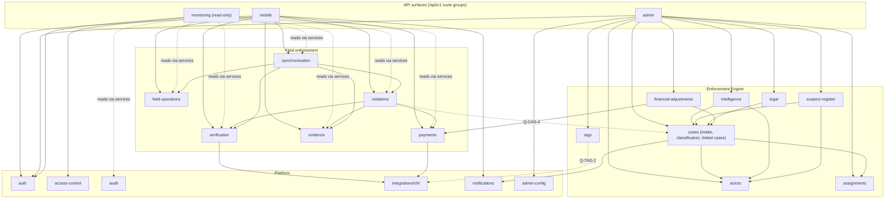

# Component boundaries

**Phase 2: architecture proposal, awaiting review.** Labels **[C] [R] [P] [Q]**
are explained in [system-context.md](system-context.md#how-to-read-the-labels).

## Shape of the backend

**[P]** One deployable modular monolith (Express, PostgreSQL), split into the
domain modules below ([ADR-0005](../decisions/0005-modular-monolith.md)). No
source document or deployment constraint requires separately deployed
services.

Inside a module (Phase 1 convention, unchanged):

```
routes → controller → service → repository → Prisma (ITEIME database)
                         └────→ integrations/chl → CHL
```

- Routes and controllers are thin. Services hold the business rules,
  transactions, authorization decisions and audit events. Repositories only
  persist.
- Only `src/integrations/chl` talks to CHL
  ([ADR-0006](../decisions/0006-chl-integration-boundary.md)).
- `src/shared` holds technical code only, never business rules.
- One module may call another module's **service**, never its repository or
  tables.
- Small modules may merge layers.

**What exists today:** `src/modules/health`, `src/integrations/chl` (types
only), and `src/routes/v1` (empty). Everything below is a proposal.

## Maturity scale

How completely the sources specify each domain:

| Grade         | Meaning                                                                        |
| ------------- | ------------------------------------------------------------------------------ |
| **Specified** | Behaviour, rules and most fields are stated in a source                        |
| **Partial**   | Features are listed, but rules, fields or states are missing                   |
| **Thin**      | Named with one-line features; key decisions are open                           |
| **Undefined** | Can't be designed without external input (a contract, a provider, an approval) |

## Domain overview

| #   | Domain (module)                                                    | Main sources                               | Owner of the data                                        | Consumers                   | Maturity                                       | Blocking questions         |
| --- | ------------------------------------------------------------------ | ------------------------------------------ | -------------------------------------------------------- | --------------------------- | ---------------------------------------------- | -------------------------- |
| 1   | CHL adapter (`integrations/chl`)                                   | SRD §31, §37; T18.3; REQ                   | CHL                                                      | Internal modules            | Undefined                                      | Q-CHL-1, Q-CHL-2, Q-CHL-6  |
| 2   | Auth integration (`auth`)                                          | SRD §5; T17.1, T18.1; MON §1               | CHL (identity); ITEIME (sessions?)                       | All clients                 | Partial                                        | Q-CHL-2, Q-CHL-3           |
| 3   | RBAC and scope (`access-control`)                                  | SRD §4, §22, §28; MON §1, §4, §12.4; T18.1 | CHL (roles, scopes)                                      | All modules                 | Partial                                        | Q-ROL-1, Q-ROL-7, Q-CHL-10 |
| 4   | Verification (`verification`)                                      | SRD §8–17, §25, §28; T17.2; MON §6         | CHL computes or ITEIME combines; the record is undecided | Mobile; Monitoring          | Specified rules, undefined contract            | Q-CHL-6, Q-CHL-7, Q-REP-9  |
| 5   | Field operations (`field-operations`)                              | SRD §2, §7.1, §27; T16, T17.8; MON §3      | ITEIME (proposed)                                        | Mobile; Monitoring; Admin   | Partial                                        | Q-REP-7                    |
| 6   | Violations (`violations`)                                          | SRD §13, §18–22; T17.3; MON §8             | Undecided (CHL or ITEIME)                                | Mobile; Monitoring          | Specified workflow, undecided ownership        | Q-CHL-7, Q-ROL-2, Q-VER-2  |
| 7   | Evidence (`evidence`)                                              | SRD §24; T2.6, T17.4; MON §9               | ITEIME (proposed)                                        | Mobile; Monitoring; Admin   | Partial                                        | Q-VER-4, Q-VER-5           |
| 8   | Payment status and demand notices (`payments`)                     | SRD §23; T17.5; MON §10                    | CHL / providers (truth)                                  | Mobile; Monitoring          | Partial                                        | Q-PAY-1, Q-PAY-2, Q-PAY-3  |
| 9   | Synchronization (`synchronization`)                                | SRD §26, §33.2; T16.5, T17.6; MON §13      | ITEIME                                                   | Mobile; Monitoring          | Partial                                        | Q-SYN-1, Q-SYN-2           |
| 10  | Notifications (`notifications`)                                    | SRD §29–30; T1.5, T15, T17.7; MON §11      | ITEIME                                                   | All clients                 | Partial                                        | Q-NOT-1, Q-SYN-3           |
| 11  | Monitoring read models (`monitoring`)                              | MON §2–§13; SRD §7.2                       | Derived (no data of its own)                             | Monitoring; supervisors     | Partial (MON is detailed, its source is not)   | Q-CHL-5, Q-SYN-6           |
| 12  | Audit (`audit`)                                                    | SRD §28; T2.7, T11.6, T18.2; MON §12       | ITEIME                                                   | Administrators; supervisors | Specified for verifications, partial elsewhere | Q-OPS-2, Q-CHL-7           |
| 13  | Cases (`cases`), including intake, classification and linked cases | T1, T2, T4, T5; T12, T13                   | ITEIME                                                   | Admin                       | Partial                                        | Q-CAS-1, Q-CAS-2, Q-CAS-3  |
| 14  | Actors (`actors`)                                                  | T3                                         | ITEIME                                                   | Admin                       | Partial                                        | Q-CAS-5                    |
| 15  | Classification (inside `cases`)                                    | T4; T10.1–10.3                             | ITEIME                                                   | Admin                       | Partial                                        | Q-CAS-4                    |
| 16  | Linked cases (inside `cases`)                                      | T5                                         | ITEIME                                                   | Admin                       | Partial                                        | Q-CAS-1                    |
| 17  | Assignments (`assignments`)                                        | T2.1, T12.2–12.4, T13.1                    | ITEIME                                                   | Admin                       | Thin                                           | Q-ROL-8, Q-CAS-6           |
| 18  | Tags (`tags`)                                                      | T6; REQ E2                                 | CHL (issuance) / undecided (workflow)                    | Admin                       | Thin                                           | Q-TAG-1, Q-TAG-2           |
| 19  | Intelligence (`intelligence`)                                      | T7                                         | ITEIME (derived)                                         | Admin                       | Thin                                           | Q-CAS-7                    |
| 20  | Suspect register (`suspect-register`)                              | T8                                         | ITEIME (derived)                                         | Admin                       | Thin                                           | Q-CAS-13, Q-OPS-1          |
| 21  | Legal (`legal`)                                                    | T9                                         | ITEIME                                                   | Admin (Legal)               | Thin                                           | Q-ROL-6                    |
| 22  | Financial adjustments (`financial-adjustments`)                    | T11                                        | ITEIME (approval: undecided)                             | Admin (Finance)             | Undefined (approval authority)                 | Q-PAY-4, Q-PAY-5           |
| 23  | Communication (`communications`)                                   | T14                                        | ITEIME                                                   | Admin                       | Undefined (infrastructure)                     | Q-NOT-2                    |
| 24  | Admin configuration (`admin-config`)                               | T18.4                                      | ITEIME (or CHL for categories)                           | Admin                       | Thin                                           | Q-CAS-2, Q-VER-3           |
| 25  | EDMS / AI case structuring                                         | T10                                        | Undefined                                                | Admin                       | Undefined (no module proposed yet)             | Q-CAS-8                    |

## Merges, splits and non-domains (with rationale)

- **[P] Classification and linked cases live in `cases`.** The case type is
  mandatory and checked when a case is created (T4.1). A child case is itself a
  case with its own ID and lifecycle, linked to its parent (T5.2–5.3). Both
  share the case aggregate's invariants (valid transitions, audit), so separate
  modules would need cross-module transactions for one change. They can be
  split later if they grow their own lifecycle.
- **[P] T1 Control Center is the intake part of `cases`.** Logging a call
  produces a case (T1.2–T1.4). The SMS confirmation (T1.5) is sent through
  `notifications`.
- **[P] T12 and T13 are not backend domains.** They are dashboard workflows
  over `cases`, `assignments` and `access-control` (scope by state or national).
  Separate backend domains would duplicate case logic.
- **[P] "Mobile API" (T17) is an API surface, not a domain.** The `/api/v1`
  mobile route group is composed from `auth`, `verification`,
  `field-operations`, `violations`, `evidence`, `payments`, `synchronization`
  and `notifications`. `field-operations` holds what has no other home:
  dashboard metrics, history, field reports, SOS, loaded/empty and
  destination-location reports.
- **[P] T16 (Enforcement Field App) merges with the mobile surface.** Its items
  (incident reporting, escalation, case updates, GPS, offline sync) map onto
  `field-operations`, `cases` and `synchronization`. Whether a field incident
  is an ITEIME case is still open (Q-CAS-4).
- **[P] `verification` is split from `violations`.** The SRD keeps "identify
  breach" separate from "issue violation" (§20), and an absent active trip
  does not by itself prove a violation (§13.4). A verification never creates a
  violation; the agent's action does.
- **[P] `monitoring` owns no tables.** It serves read models over other
  modules' data, filtered by scope
  ([ADR-0008](../decisions/0008-monitoring-read-models.md)). It has no write
  routes.
- **[P] T10 (EDMS / AI) is not given a module.** No AI service is approved
  (`CLAUDE.md` §4), and EDMS is undefined. The metadata tagging and complexity
  tagging in T10.2–10.3 can be case attributes in `cases` once they are
  defined.

## Domain details

Each entry: **Responsibilities**, **Inputs → outputs**, **Depends on**, **Data**,
**Consumers**, **Security and audit**, **Maturity and gaps**.

### 1. CHL adapter (`src/integrations/chl`)

- **Responsibilities:** the only route to CHL. Maps CHL responses into ITEIME
  types; enforces timeouts and bounded retries for idempotent calls only; maps
  every failure to `ChlError` ([C] SRD §26.2, §33.2, acceptance criterion 12).
- **Inputs → outputs:** typed requests from services → typed results, or
  `ChlError` (`unavailable`, `unauthorized`, `invalid_response`,
  `not_configured`).
- **Depends on:** the CHL API (no contract yet).
- **Data:** none persisted. CHL remains authoritative.
- **Consumers:** auth, verification, payments, reference data, tags, monitoring.
- **Security and audit:** server-to-server credentials kept only in
  configuration; raw RFID values and tokens never logged; every failed call
  logged with its request ID.
- **Maturity and gaps:** Undefined until CHL sends a contract (Q-CHL-1, Q-CHL-2,
  Q-CHL-6, Q-CHL-13). A deterministic test double is proposed for Phase 3.

### 2. Auth integration (`auth`)

- **Responsibilities:** agent sign-in with CHL credentials; refresh; logout;
  forgot password (handed to CHL's process); 24-hour session limit; immediate
  denial on deactivation ([C] SRD §5; acceptance criteria 1–2). Dashboard
  sign-in through CHL ([C] MON §1).
- **Inputs → outputs:** credentials → session (tokens) and the user's profile,
  role and scope.
- **Depends on:** the CHL adapter; `access-control`; `audit`.
- **Data:** CHL owns identities. ITEIME may hold sessions, only if it issues its
  own tokens (Q-CHL-2). Tokens are stored only as hashes [P].
- **Consumers:** every client.
- **Security and audit:** rate-limited sign-in; every sign-in attempt audited
  (successful or not); no account enumeration on forgot-password [P].
- **Maturity and gaps:** Partial. The token issuer and the deactivation
  signal are open (Q-CHL-2, Q-CHL-3).

### 3. RBAC and geographic scope (`access-control`)

- **Responsibilities:** server-side role and scope checks on every route ([C]
  SRD §5.4, MON §1, `CLAUDE.md` §7); a separate permission set for each client
  surface.
- **Inputs → outputs:** principal, action and resource → allow or deny, plus
  scope filters for queries.
- **Depends on:** `auth` (principal); CHL (role names, scope assignments,
  geographic hierarchy; Q-CHL-10).
- **Data:** none authoritative. A cache of the geographic hierarchy may be
  needed (Q-CHL-14).
- **Consumers:** every module.
- **Security and audit:** default deny. Every denial is logged, and also
  audited where it touches sensitive data [P].
- **Maturity and gaps:** Partial. The roles are named, but the permission
  matrix is missing (Q-ROL-1 to Q-ROL-9). Agents must not be blocked from
  verifying outside their scope ([C] SRD §4.1).

### 4. Verification (`verification`)

- **Responsibilities:** one verification flow for RFID, QR, plate and
  OCR-confirmed plate ([C] SRD §8); plate normalization ([C] §11); multi-tag
  resolution ([C] §9.6); results that keep vehicle, E-Tag and trip apart ([C]
  §13, §15); last trip and no trip history ([C] §17); trip refresh; recording
  every attempt ([C] §28).
- **Inputs → outputs:** method, identifier, GPS and device metadata → a
  verification record and result, or **verification unavailable** (never a
  negative result; [C] §26.2).
- **Depends on:** the CHL adapter; `audit`; `synchronization` (offline
  captures).
- **Data:** verification attempts. ITEIME versus CHL as record holder is
  undecided (Q-CHL-7). Proposed: ITEIME stores the attempt and a snapshot of
  what the agent was shown ([ADR-0007](../decisions/0007-chl-data-reference-strategy.md)).
- **Consumers:** mobile (create, read own); monitoring (read, scoped).
- **Security and audit:** the raw identifier is stored but never returned to
  agents ([C] §9.4); access to it is privileged (Q-ROL-4); GPS is required
  (Q-VER-1).
- **Maturity and gaps:** the rules are Specified; the CHL contract and the
  result vocabulary are open (Q-CHL-6, Q-REP-9).

### 5. Field operations (`field-operations`)

- **Responsibilities:** agent dashboard metrics and the five most recent
  verifications ([C] SRD §7.1); personal history, last 30 days plus "view all"
  ([C] §27); field reports: SOS, vehicle, driver and situation reports, notify
  system, loaded/empty ([C] §2 item 17); destination-location reports ([C]
  §14.2, §25; REQ D2).
- **Inputs → outputs:** agent reports with GPS → stored reports; read views for
  the agent.
- **Depends on:** `verification`; `notifications`; the CHL adapter (destination
  check, if CHL stores it; REQ §8 Q6).
- **Data:** ITEIME-owned field reports [P]. Their payload fields are not
  defined in the sources.
- **Consumers:** mobile; Monitoring (Command Centre feed, MON §3); Admin
  (possibly, T16.1).
- **Security and audit:** SOS may need priority handling; it is in the audit
  log; the location is never fabricated.
- **Maturity and gaps:** Partial. Report payloads and SOS handling are
  undefined.

### 6. Violations (`violations`)

- **Responsibilities:** create a violation after a breach is identified ([C]
  SRD §20); categories retrieved from the backend ([C] §19); statuses Payment
  Pending, Resolved, Escalated and Cancelled, plus internal states ([C] §21);
  close or cancel by authorized roles or automatically after confirmed payment
  ([C] §22); never submitted without mandatory evidence ([C] §20, §24.1;
  acceptance criterion 19); no duplicates from offline retries ([C] §33.2).
- **Inputs → outputs:** verification reference, category, notes, evidence
  references, GPS → a violation with its reference; status changes.
- **Depends on:** `verification`; `evidence`; `payments`; `access-control`;
  `audit`; possibly `cases` (Q-CAS-4).
- **Data:** the owner is undecided (Q-CHL-7). MON says violations are "received
  by CHL".
- **Consumers:** mobile (create, read own); Monitoring (read, scoped); Admin
  (if linked to cases).
- **Security and audit:** every status change audited with the actor; the
  closure authority comes from Q-ROL-2 and must not be invented.
- **Maturity and gaps:** the workflow is Specified; ownership, the category
  list (X6) and the closure rules are open.

### 7. Evidence (`evidence`)

- **Responsibilities:** accept camera evidence: several photos, with types
  front, rear, side, missing tag, fake/invalid tag, haulage bay and other ([C]
  SRD §24.2); keep metadata without a watermark ([C] §24.4); resumable uploads
  ([C] T17.4); read-only viewing for monitoring ([C] MON §9).
- **Inputs → outputs:** upload sessions and file parts → stored files and
  evidence records; signed and scoped read access.
- **Depends on:** a storage provider behind an interface (Q-VER-4); `audit`.
- **Data:** ITEIME-owned metadata [P]. Files go in external storage [P].
- **Consumers:** mobile (upload); Monitoring (view); Admin (case evidence,
  T2.6, T13.2).
- **Security and audit:** uploads treated as untrusted (type and size
  checks); least-privilege access; every view of sensitive evidence audited
  [P]; no editing of captured metadata ([C] MON §9).
- **Maturity and gaps:** Partial. Storage, limits, retention and how
  camera-only capture is enforced are all open (Q-VER-4, Q-VER-5).

### 8. Payment status and demand notices (`payments`)

- **Responsibilities:** demand notice (vehicle, CHL levy, penalty, total,
  methods, reference, QR) ([C] SRD §23, §34 screen 11); live status Payment
  Pending → Payment Received → CHL Trip Activated, with "received" and
  "activated" kept apart ([C] §23.2; MON §10).
- **Inputs → outputs:** violation → demand notice (wherever it is generated);
  authoritative payment events → status.
- **Depends on:** the CHL adapter or payment providers (Q-PAY-1, Q-PAY-2).
- **Data:** CHL and the providers hold the truth. ITEIME keeps references and
  the last known status, with the time it was fetched [P].
- **Consumers:** mobile; Monitoring.
- **Security and audit:** a client can never mark a demand paid ([C]
  `CLAUDE.md` §7); webhooks must be signature-verified [P] (Q-PAY-2); every
  status change audited.
- **Maturity and gaps:** Partial; the generator and the source of truth are
  open.

### 9. Synchronization (`synchronization`)

- **Responsibilities:** offline cache downloads ([C] SRD §26.1); upload of
  queued actions with idempotency, safe retries and duplicate prevention ([C]
  §26.3, §33.2); a sync status for each record ([C] §28; MON §13).
- **Inputs → outputs:** batches or individual actions with idempotency keys →
  per-item results (accepted, duplicate, conflict, rejected).
- **Depends on:** `verification`, `violations`, `evidence`, `field-operations`.
- **Data:** idempotency records; sync metadata on each record (ITEIME) [P].
- **Consumers:** mobile; Monitoring (shows sync status).
- **Security and audit:** keys scoped per agent; replays rejected after a
  window (Q-SYN-5); conflicts audited.
- **Maturity and gaps:** Partial. Freshness, conflict rules and the age limit
  are open (Q-SYN-1, Q-SYN-2, Q-SYN-5).

### 10. Notifications (`notifications`)

- **Responsibilities:** in-app inbox, push, SMS and email ([C] SRD §29–30;
  T15.1–15.4); repeat-vehicle alerts ([C] §29); escalation alerts ([C] T15.4);
  taxpayer SMS confirmation ([C] T1.5); taxpayer status query ([C] T15.5).
- **Inputs → outputs:** domain events → notifications per recipient and
  channel; read or unread state.
- **Depends on:** provider interfaces (Q-NOT-1); `access-control` (recipients).
- **Data:** ITEIME-owned notifications and delivery attempts [P].
- **Consumers:** mobile; Admin; Monitoring (field and enforcement
  notifications, MON §11).
- **Security and audit:** no sensitive identifiers in SMS or push text [P];
  delivery failures recorded.
- **Maturity and gaps:** Partial. Providers, guarantees and the repeat-alert
  criteria are open (Q-NOT-1, Q-SYN-3, Q-NOT-3).

### 11. Monitoring read models (`monitoring`)

- **Responsibilities:** the 13 MON modules as read-only queries: overview, the
  Command Centre feed, geographic views, agents, verification and E-Tag, trips,
  violations, evidence, payments, notifications, audit, and sync ([C] MON
  §1–§13); the supervisor metrics ([C] SRD §7.2).
- **Inputs → outputs:** scoped queries → aggregated, paginated views, each
  with "last updated" stamps.
- **Depends on:** the other modules' services; the CHL adapter for trips and
  payments (Q-CHL-5).
- **Data:** none of its own [P]. It must not compute trip validity itself
  ([C] MON §7).
- **Consumers:** the Monitoring Dashboard; the supervisor view (Q-ROL-9).
- **Security and audit:** GET only; scope filter on every query; raw RFID
  hidden ([C] MON §6); audit access only for authorized administrators ([C] MON
  §12.4).
- **Maturity and gaps:** the views are well described; the data source
  (X2) and freshness (Q-SYN-6) are open.

### 12. Audit (`audit`)

- **Responsibilities:** the verification audit fields ([C] SRD §28); case
  history ([C] T2.7); financial audit logs ([C] T11.6); platform audit
  ([C] T18.2); complete audit access for administrators with no edit or delete
  ([C] MON §12.4).
- **Inputs → outputs:** audit events from every module → an append-only store
  and scoped reads.
- **Depends on:** nothing (it is the base of the dependency graph).
- **Data:** ITEIME-owned [P].
- **Consumers:** administrators; supervisors (scoped; Q-ROL-5).
- **Security and audit:** append-only at the application level; tamper
  evidence is open (Q-OPS-2); access to the audit log is itself audited.
- **Maturity and gaps:** the verification fields are Specified; integrity and
  retention are open (Q-OPS-1, Q-OPS-2).

### 13. Cases (`cases`): intake, lifecycle, classification, linked cases

- **Responsibilities:** call intake and the structured form: name, phone,
  plate, location, case type, actors ([C] T1.2); case ID generation ([C] T1.3);
  call log with timestamps ([C] T1.4); lifecycle with valid transitions and
  timestamps ([C] T2.1–2.4); SLA timers ([C] T2.3); metadata and status layers
  ([C] T2.5); mandatory case type and filtering ([C] T4); parent and child
  cases with a parent summary ([C] T5); investigation updates, notes and
  findings ([C] T13.3–13.4).
- **Inputs → outputs:** intake data → a case; transition commands → a new
  stage plus a history entry; queries.
- **Depends on:** `actors`; `assignments`; `notifications`; `audit`;
  `access-control`.
- **Data:** ITEIME-owned [C] (the PRD scope is ITEIME's own data).
- **Consumers:** the Admin Dashboard (Control Center, Central Enforcement,
  State IRS, Legal).
- **Security and audit:** every transition audited ([C] T2.7); invalid
  transitions rejected ([C] T2.2); the reporter's personal data handled
  carefully (Q-OPS-1).
- **Maturity and gaps:** Partial. Lifecycle version, transitions, SLAs, ID
  format and status layers are open (Q-CAS-1, Q-CAS-2, Q-CAS-3, Q-CAS-10).

### 14. Actors (`actors`)

- **Responsibilities:** actor types IRS, Police, Enforcement Agents and
  Civilian/Unknown ([C] T3.1); several actors per case, each tracked
  independently ([C] T3.2–3.3); cross-agency routing ([C] T3.4);
  auto-escalation when there are several actors ([C] T3.5).
- **Inputs → outputs:** actor details per case → actor records; routing and
  escalation events.
- **Depends on:** `cases`; `notifications`.
- **Data:** ITEIME-owned. An actor may be an unidentified person
  (description only).
- **Consumers:** Admin; `suspect-register` (aggregation input).
- **Security and audit:** personal data about third parties; audited changes.
- **Maturity and gaps:** Partial. Routing and escalation rules are open
  (Q-CAS-5).

### 15. Classification (inside `cases`)

- **Responsibilities:** mandatory case type ([C] T4.1); categories Harassment,
  Cash collection, Unauthorized collection, Wrong categorization and Tag issues
  ([C] T4.2); filtering ([C] T4.3); the T10.1 classification (Taxpayer,
  Enforcer, State IRS, Law enforcement) and complexity tagging when defined.
- **Data:** a configurable category list (`admin-config`, T18.4) [P].
- **Maturity and gaps:** Partial. How it relates to violation categories is
  open (Q-CAS-4).

### 16. Linked cases (inside `cases`)

- **Responsibilities:** split a case into child cases, each with its own ID
  and lifecycle; the parent–child link; a parent summary of the children ([C]
  T5.1–5.4).
- **Maturity and gaps:** Partial. Whether a parent can close while children
  are open is not stated (Q-CAS-1).

### 17. Assignments (`assignments`)

- **Responsibilities:** assign enforcement teams; track deployment status
  ([C] T12.2–12.3); assigned cases for State IRS ([C] T13.1); the Assignment
  stage of the lifecycle ([C] T2.1); cross-state coordination ([C] T12.4).
- **Data:** ITEIME-owned assignments [P]. Teams and units are not defined in
  any source.
- **Maturity and gaps:** Thin. The team model, deployment statuses and
  jurisdiction rules are open (Q-ROL-8, Q-CAS-6).

### 18. Tags (`tags`)

- **Responsibilities:** tag status and lifecycle tracking ([C] T6.1); the
  tampering and non-pickup rules ([C] T6.2–6.3); physical-tag tracking ([C]
  T6.4); issue reporting by support agents ([C] T6.5).
- **Data:** CHL owns tag issuance and registration ([C] SRD §3.2). Who owns the
  logistics workflow is undecided (Q-TAG-2).
- **Maturity and gaps:** Thin. The statuses are explicitly unassigned in the
  source (Q-TAG-1).

### 19. Intelligence (`intelligence`)

- **Responsibilities:** location tracking by State, LGA, Area and Bus Stop
  ([C] T7.1); frequency counts; high-risk zones by threshold; repeated
  violations; trends ([C] T7.2–7.5).
- **Data:** derived from cases and actors, and perhaps verifications [P].
  Stored flags only once thresholds are defined.
- **Maturity and gaps:** Thin. The thresholds are open (Q-CAS-7).

### 20. Suspect register (`suspect-register`)

- **Responsibilities:** aggregation by actor description and location, with
  case count, case types, search and filtering ([C] T8).
- **Data:** **[P] a derived view over `actors` and `cases`**, not a separately
  maintained list, until the privacy basis is confirmed (Q-CAS-13).
- **Maturity and gaps:** Thin.

### 21. Legal (`legal`)

- **Responsibilities:** access to escalated cases; review notes; mark for
  prosecution; prosecution support ([C] T9).
- **Maturity and gaps:** Thin. The source itself says Legal is the least
  defined (ITEIME notes; Q-ROL-6).

### 22. Financial adjustments (`financial-adjustments`)

- **Responsibilities:** "Payment Under Duress – Verified" marking; refund
  calculation; notifying the finance unit; deduction from IRS remittance
  (enforcement budget only, not IGR); refund issuing and tracking within the
  SLA; financial audit logs ([C] T11.1–11.6).
- **Security and audit:** approval authority must not be invented, and refunds
  must not be automated ([C] `CLAUDE.md` §7). Every step is audited.
- **Maturity and gaps:** Undefined until the approval authority and the
  remittance interface are known (Q-PAY-4, Q-PAY-5).

### 23. Communication (`communications`)

- **Responsibilities:** one-to-one, group and case-linked chat; WebRTC voice;
  file sharing; encryption ([C] T14).
- **Maturity and gaps:** Undefined. It needs real-time infrastructure that
  `CLAUDE.md` §4 says not to add without justification (Q-NOT-2).

### 24. Admin configuration (`admin-config`)

- **Responsibilities:** SLA settings and categories ([C] T18.4).
- **Maturity and gaps:** Thin. It may overlap with CHL configuration of
  violation categories and charges (Q-VER-3).

### 25. EDMS / AI case structuring (T10)

No module is proposed. See the merge notes above and Q-CAS-8.

## Module dependencies (proposed)



Every module also depends on `access-control` and `audit`; those edges are left
out of the diagram for readability.
