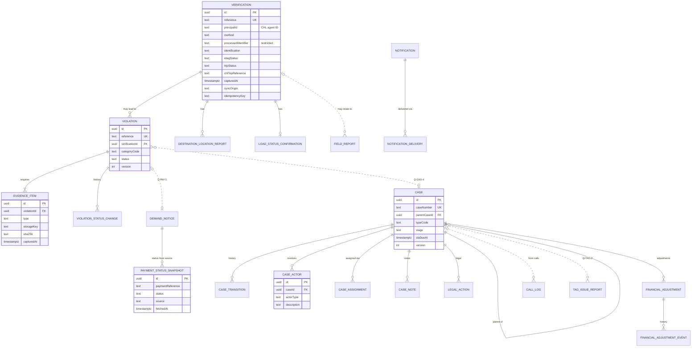
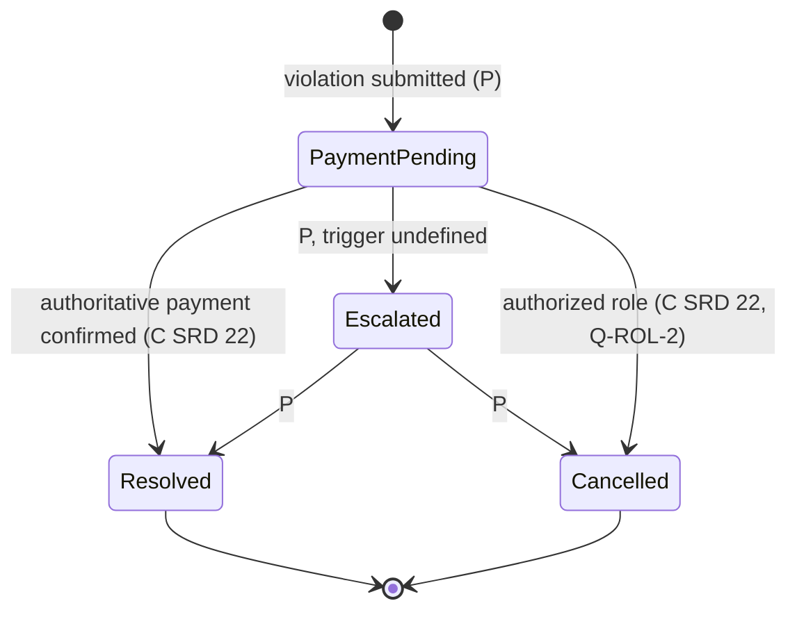
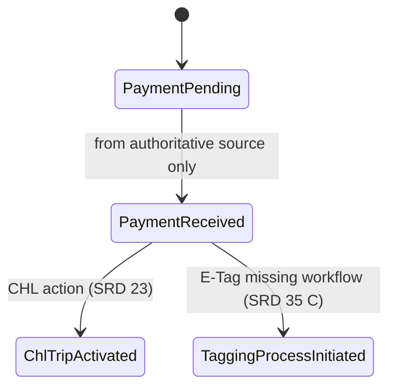

# Data model proposal

**Phase 2: proposal for review. Not a schema.** No Prisma models or migrations
are created from this document until the ownership decisions it depends on are
answered and the model is approved. `prisma/schema.prisma` still has no
models.

Labels **[C] [R] [P] [Q]** are explained in
[system-context.md](system-context.md#how-to-read-the-labels). For each entity:

- **Confirmed:** fields or rules stated in a source, with a citation.
- **Inferred:** proposals needed to make the confirmed behaviour work.
- **Unresolved:** open questions that could change or remove the entity.

## Modelling conventions [P]

- Primary keys are UUIDs (`id`). Human-facing references (case IDs, violation
  references) are separate, unique columns.
- Timestamps are `timestamptz` in UTC: `createdAt` and `updatedAt`, plus
  event-specific times (`capturedAt`: when it happened on the device;
  `receivedAt`: when the server got it).
- CHL entities are referenced by CHL identifiers in text columns named
  `chl…Id` or `…Reference`. They are never foreign keys to local copies
  ([ADR-0007](../decisions/0007-chl-data-reference-strategy.md)).
- People are referenced by a principal ID (a CHL agent or user ID, or an ITEIME
  user ID once Q-ROL-1 is answered). A name or role shown in audit records is a
  snapshot taken at that time.
- Status fields use database enums or checked text only for **confirmed**
  value lists. Where the values are unresolved, they use plain text plus
  validation in code, so the list can change without a migration.
- Records that can be edited carry `version` (optimistic concurrency). Records
  that must not change (history, audit, snapshots) are insert-only.
- Location: `latitude` and `longitude` (WGS84 decimal degrees), `accuracyMetres`,
  `locationCapturedAt`, and `enforcementPointRef` where known. These are never
  defaulted.

## Entity catalogue

### Platform

#### AuditEvent

- **Purpose:** an append-only record of security-relevant and business actions
  ([C] SRD §28; T2.7, T11.6, T18.2; MON §12.4 "no editing or deleting").
- **Confirmed:** who acted, when, and what action ([C] T18.2); administrators
  have complete access ([C] SRD §28).
- **Inferred:** `id`, `occurredAt`, `actorPrincipalId`, `actorRoleSnapshot`,
  `action`, `outcome` (success, denied, failed), `subjectType`, `subjectId`,
  `requestId`, `ip`, `details` (JSON, redacted). Insert-only at the
  application level.
- **Unresolved:** tamper evidence (hash chain?), retention, and supervisor
  scope (Q-OPS-2, Q-OPS-1, Q-ROL-5).
- **Sensitive:** never stores tokens, passwords or raw RFID values in
  `details`.

#### IdempotencyRecord

- **Purpose:** makes offline and retried writes safe ([C] SRD §33.2 "avoid
  duplicate submission").
- **Inferred:** `principalId` plus `key` (unique together), `operation`,
  `requestHash`, `responseStatus`, `responseBody` or `resultRef`,
  `createdAt`, `expiresAt`. The same key with a different `requestHash` is a
  conflict.
- **Unresolved:** the key format and the retention window (Q-SYN-2, Q-SYN-5).

#### Session (conditional)

- **Purpose:** only if ITEIME issues its own tokens (Q-CHL-2).
- **Confirmed:** access and refresh tokens; absolute 24-hour expiry; denial on
  deactivation ([C] SRD §5.3–5.4).
- **Inferred:** `principalId`, hashes of both tokens (unique), `accessExpiresAt`,
  `expiresAt` (24 h, absolute), `revokedAt`, `revokedReason`, `device`
  (JSON). If CHL tokens must be held for relaying, they need encryption at rest
  (no key service is chosen; Q-OPS-1).

### Field enforcement

#### Verification

- **Purpose:** one record per verification attempt, successful or not ([C] SRD
  §28, acceptance criterion 27).
- **Confirmed fields** ([C] SRD §28): agent ID; agent name; vendor or
  organization; date and time; verification method; processed identifier;
  vehicle ID where resolved; plate where resolved; verification result; trip
  reference; violation reference; GPS location; enforcement point; device and
  app metadata; action taken; synchronization status. Methods: RFID, QR,
  manual plate, OCR plate ([C] §8). Plates are normalized ([C] §11).
  Completion status, action taken, violation issued, payment generated and
  pending action are shown in history ([C] §27.1).
- **Inferred:**
  - `reference` (human-readable, unique); `principalId` plus snapshots of name
    and organization; `method`; `processedIdentifier` (restricted column;
    never returned to agents, [C] §9.4); `normalizedPlate`; `chlVehicleId`.
  - The result as **separate components**: `identification` (identified, not
    found, unknown tag, unavailable), `etagStatus` (valid, invalid, missing,
    mismatch, not checked), `tripStatus` (active, no active trip, no trip
    history, expired/previous, not checked); plus `srdResult`, **derived** from
    the components (§15). See Q-REP-9.
  - `completed` (false when unavailable); `resultSnapshot` (JSON: what the
    agent was shown, with `fetchedAt`); `chlTripReference`;
    `chlVerificationReference` (if CHL keeps one; REQ V6).
  - Location fields (see the conventions); `enforcementPointRef`;
    `syncOrigin` (live, offline); `capturedAt`; `receivedAt`;
    `idempotencyKey` (unique per principal); `actionTaken`; `haulageConfirmed`
    (the agent's confirmation that the vehicle carries haulage goods; [C]
    §13.4).
- **Relationships:** one verification has 0..n violations, 0..n
  destination-location reports, and 0..1 load-status confirmation.
- **Unresolved:** whether ITEIME is the record holder (Q-CHL-7); the result
  vocabulary (Q-REP-9); behaviour without GPS (Q-VER-1); retention (Q-OPS-1).

#### DestinationLocationReport

- **Purpose:** the agent's location sent for an active trip's destination
  detection ([C] SRD §14.2, §25; REQ D2).
- **Inferred:** `verificationId`, `chlTripReference`, location fields,
  `completionDecisionSnapshot`, `capturedAt`.
- **Unresolved:** whether CHL stores it instead (Q-CHL-7).

#### LoadStatusConfirmation

- **Purpose:** whether a vehicle is loaded or empty ([C] SRD §2 item 17,
  §13.4).
- **Confirmed values:** loaded, empty ([C] SRD §2 "Confirm loaded / empty
  status").
- **Inferred:** `verificationId` (unique), `status`, location fields,
  `capturedAt`, `principalId`.

#### FieldReport

- **Purpose:** SOS, vehicle report, driver report, situation report, and
  notify system ([C] SRD §2 item 17; MON §3, §11.3).
- **Confirmed types:** SOS, vehicle, driver, situation, notify system.
- **Inferred:** `type`, `principalId`, location fields, `capturedAt`,
  `receivedAt`, `body` (text), `relatedVerificationId` (optional),
  `idempotencyKey`, `status` (open or acknowledged, for SOS).
- **Unresolved:** each report's fields and SOS handling (no source defines
  them).

#### Violation

- **Purpose:** an enforcement violation issued by an agent ([C] SRD §20).
- **Confirmed:**
  - Categories: No Active CHL Trip, No E-Tag, Fake/Invalid E-Tag, Tampered
    E-Tag, Expired Trip, Refusal to Comply ([C] §19); the list is configurable
    ([C] §19).
  - Statuses: Payment Pending, Resolved, Escalated, Cancelled, plus internal
    states ([C] §21).
  - Reference generated on submit ([C] §20). Notes ([C] §20).
  - Mandatory evidence: photo, GPS, date and time, agent identity, plate ([C]
    §24.1).
- **Inferred:** `reference` (unique); `verificationId`; `categoryCode`;
  `status` (text, validated in code, because internal states are open);
  `notes`; `principalId`; location fields; `capturedAt`; `idempotencyKey`;
  `version`. Insert-only `ViolationStatusChange` rows (from, to, actor,
  reason, at). Submission requires at least one evidence item of type vehicle
  photo, checked in the service ([C] acceptance criterion 19).
- **Relationships:** n violations belong to one verification; one violation
  has 1..n evidence items and 0..1 demand notice; it may link to a case
  (Q-CAS-4).
- **Unresolved:** the record holder (Q-CHL-7); the category list (X6, Q-VER-2,
  Q-VER-3); the closure authority (Q-ROL-2); the reference format (Q-VER-8).

#### EvidenceItem

- **Purpose:** metadata for one captured file ([C] SRD §24).
- **Confirmed:** several photos; types front, rear, side, missing E-Tag,
  fake/invalid tag, haulage bay, other ([C] §24.2). Metadata: capture
  timestamp, GPS, agent identity, violation reference, with no watermark ([C]
  §24.4). Camera only ([C] §24.3).
- **Inferred:** `violationId` (or a polymorphic owner, if cases use it;
  Q-CAS-12), `type`, `storageKey`, `contentType`, `sizeBytes`, `sha256`,
  `capturedAt`, location fields, `principalId`, `uploadStatus` (pending,
  complete, failed).
- **Unresolved:** storage, limits, retention, the resumable protocol, and how
  camera-only is enforced (Q-VER-4, Q-VER-5).
- **Sensitive:** vehicle and driver images. Access is scoped, and views are
  audited.

#### DemandNotice (conditional on Q-PAY-1)

- **Confirmed fields** ([C] SRD §23, §34 screen 11): vehicle details, CHL levy,
  penalty, total payable, available payment methods, payment reference,
  payment QR where applicable.
- **Inferred:** if ITEIME generates it: `violationId` (unique), amounts in
  minor units plus currency, `paymentReference` (unique), `status`. If CHL
  generates it: a REF row with a snapshot only.

#### PaymentStatusSnapshot

- **Purpose:** the last known payment and compliance status from the
  authoritative source ([C] SRD §23.2; MON §10).
- **Confirmed values:** Payment Pending, Payment Received, CHL Trip Activated
  (kept distinct) ([C] §23.2; MON §10).
- **Inferred:** `paymentReference`, `status`, `source`, `fetchedAt`. Insert-only
  history. **Never written from client input** ([C] `CLAUDE.md` §7).

#### RepeatVehicleAlert

- **Confirmed:** raised after the third qualifying report without appropriate
  follow-up; delivered by push and in-app notification ([C] SRD §29); not after
  any three scans ([C] MON §11.1).
- **Inferred:** `chlVehicleId` or `normalizedPlate`, `qualifyingReportIds`,
  `raisedAt`, `status` (open, actioned).
- **Unresolved:** the criteria and who receives the alert (Q-SYN-3). Nothing
  can be implemented until they are confirmed.

#### Notification and NotificationDelivery

- **Confirmed:** operational, sync, reader, repeat-vehicle and
  payment/enforcement notifications ([C] SRD §30, §34 screen 13); SMS, email
  and in-app channels ([C] T15).
- **Inferred:** `Notification` (`recipientPrincipalId`, `category`, `title`,
  `body`, `data`, `readAt`); `NotificationDelivery` (`channel`, `status`,
  `attempts`, `lastError`, `providerMessageId`); `DevicePushToken`.
- **Unresolved:** providers and guarantees (Q-NOT-1).

### Enforcement Engine

#### Case

- **Confirmed:**
  - Intake fields: name, phone, plate, location, case type, actors ([C] T1.2).
  - Case ID such as `JRB/CHL/KEB/001` ([C] T1.3).
  - Lifecycle Creation → Assignment → Investigation → Intelligence → Tactical
    → Closure → Escalation (Version 2) ([C] T2.1), with valid transitions
    enforced ([C] T2.2), SLA timers ([C] T2.3), and timestamped transitions
    ([C] T2.4).
  - Metadata: origin, actors, status layers Admin/Intelligence/Tactical ([C]
    T2.5).
  - Mandatory case type, from Harassment, Cash collection, Unauthorized
    collection, Wrong categorization, Tag issues ([C] T4.1–4.2).
  - Parent and child cases, each child with its own ID and lifecycle ([C]
    T5.1–5.3).
- **Inferred:** `caseNumber` (unique); `origin`; `typeCode`; `stage` (text,
  validated against the approved transition table); `parentCaseId` (nullable
  self-reference); `reporterName` and `reporterPhone` (personal data);
  `plate`; location (State, LGA, Area, Bus Stop; [C] T7.1); `slaDueAt`;
  `version`.
- **Unresolved:** the lifecycle version and transitions (Q-CAS-1, X3); SLA
  durations (Q-CAS-2); the ID format and sequence (Q-CAS-3); status layers
  (Q-CAS-10).

#### CaseTransition

- **Purpose:** insert-only history of stage changes ([C] T2.4, T2.7).
- **Inferred:** `caseId`, `fromStage`, `toStage`, `actorPrincipalId`, `reason`,
  `occurredAt`.

#### CallLog

- **Confirmed:** calls logged with timestamps ([C] T1.4).
- **Inferred:** `caseId` (nullable: a call may not become a case), `callerPhone`,
  `startedAt`, `endedAt`, `operatorPrincipalId`, `notes`.
- **Unresolved:** telephony integration (Q-CAS-11).

#### CaseActor

- **Confirmed:** actor types IRS, Police, Enforcement Agents, Civilian/Unknown;
  several per case; each tracked independently ([C] T3.1–3.3).
- **Inferred:** `caseId`, `actorType`, `description` (free text: the
  suspect-register key, [C] T8.1), `chlAgentId` (optional, for agents),
  `agency`, `status`.
- **Sensitive:** descriptions of third parties (Q-CAS-13).

#### CaseAssignment

- **Confirmed:** assign enforcement teams; deployment status; assigned cases
  per State IRS ([C] T12.2–12.3, T13.1).
- **Inferred:** `caseId`, `assigneeType` (team, state unit), `assigneeRef`,
  `assignedAt`, `deploymentStatus` (text, values open), `assignedBy`.
- **Unresolved:** the team model and deployment statuses (Q-ROL-8).

#### CaseNote

- **Confirmed:** investigation and resolution updates; notes and findings ([C]
  T13.3–13.4); legal review notes ([C] T9.2).
- **Inferred:** `caseId`, `kind` (investigation, finding, legal review),
  `body`, `authorPrincipalId`, `createdAt`. Insert-only (corrections are new
  notes).

#### LegalAction

- **Confirmed:** mark for prosecution; prosecution support ([C] T9.3–9.4).
- **Inferred:** `caseId`, `action`, `status`, `actorPrincipalId`, `at`.
- **Unresolved:** T9 scope and users (Q-ROL-6).

#### TagIssueReport

- **Confirmed:** tag issue reporting by support agents ([C] T6.5).
- **Inferred:** `chlEtagReference` or `chlVehicleId`, `issueType`,
  `reporterPrincipalId`, `reportedAt`, `status`, `caseId` (optional).
- **Unresolved:** the lifecycle statuses and ownership (Q-TAG-1, Q-TAG-2). No
  tag-status table is proposed until then.

#### FinancialAdjustment

- **Confirmed:** "Payment Under Duress – Verified" marking; refund
  calculation; finance notification; deduction from IRS remittance
  (enforcement budget, not IGR); refund tracking within an SLA; audit logs
  ([C] T11.1–11.6).
- **Inferred:** `caseId`, `paymentReference`, `kind` (duress verification,
  refund), `amount` (minor units) plus `currency`, `status` (text; values
  open), `requestedBy`, `version`. Insert-only `FinancialAdjustmentEvent` rows.
  **No approval columns** until the authority is defined (Q-PAY-4).
- **Unresolved:** approval, reconciliation and the remittance interface
  (Q-PAY-4, Q-PAY-5).

### Not modelled as ITEIME tables

| Data                                               | Why                                                                                         |
| -------------------------------------------------- | ------------------------------------------------------------------------------------------- |
| Agents, vehicles, E-Tags, trips, payments, tariffs | CHL-owned [C]. Referenced by ID, with snapshots on events                                   |
| Geographic hierarchy                               | CHL configuration [C] MON §4. A cache table only if Q-CHL-14 allows                         |
| Suspect register                                   | Derived from `CaseActor` and `Case` [P] (Q-CAS-13)                                          |
| Intelligence patterns                              | Derived [P]; stored flags only once thresholds are defined (Q-CAS-7)                        |
| Conversations and messages (T14)                   | Deferred (Q-NOT-2)                                                                          |
| EDMS / AI structuring (T10)                        | Undefined (Q-CAS-8)                                                                         |
| Monitoring read models                             | Queries over the tables above [P] ([ADR-0008](../decisions/0008-monitoring-read-models.md)) |

## Entity relationships

Field and relationship names are proposals. Dashed lines are relationships
that depend on open questions.

`AuditEvent`, `IdempotencyRecord`, `Session` (conditional),
`RepeatVehicleAlert` and `DevicePushToken` refer to principals and records by
ID. They are left out of the diagram for readability.

## State models

Only confirmed value lists are drawn. Transitions not stated in a source are
marked as proposals.

**Violation status** ([C] values from SRD §21; [P] transitions; Q-ROL-2 for who
may perform each):

**Payment and compliance** ([C] SRD §23.2; MON §10, which keeps "received" and
"activated" distinct):

**Case lifecycle:** [C] the stage _names_ are from T2.1 (Version 2). The
**transitions are not drawn**: T2.2 requires valid-transition enforcement but
the source does not list the valid transitions, and Version 1 differs (X3).
The transition table is a Phase 3 input that needs approval (Q-CAS-1).

## Uniqueness and idempotency [P]

| Constraint                                                                | Why                                                    |
| ------------------------------------------------------------------------- | ------------------------------------------------------ |
| `Verification(principalId, idempotencyKey)` unique                        | Offline retries create no duplicates (SRD §33.2)       |
| `Violation(principalId, idempotencyKey)` unique                           | "Avoid duplicate submission of violations" (SRD §33.2) |
| `FieldReport(principalId, idempotencyKey)` unique                         | Queued reports                                         |
| `Verification.reference`, `Violation.reference`, `Case.caseNumber` unique | Human references                                       |
| `LoadStatusConfirmation.verificationId` unique                            | One answer per verification [P]                        |
| `EvidenceItem.sha256` per violation, unique                               | The same file isn't attached twice [P]                 |

## Sensitive data and retention

| Data                                                             | Handling [P]                                                        | Retention         |
| ---------------------------------------------------------------- | ------------------------------------------------------------------- | ----------------- |
| Raw RFID / processed identifier                                  | Restricted column; never in agent responses or logs ([C] SRD §9.4)  | Q-OPS-1, Q-ROL-4  |
| GPS traces of agents                                             | Event locations only; never presented as live tracking ([C] MON §3) | Q-OPS-1           |
| Evidence images                                                  | Scoped access; views audited                                        | Q-VER-4, Q-OPS-1  |
| Reporter details (name, phone), actor descriptions, suspect data | Least privilege; masked in lists                                    | Q-CAS-13, Q-OPS-1 |
| Financial records                                                | Insert-only events; full audit                                      | Q-OPS-1           |
| Audit events                                                     | Append-only                                                         | Q-OPS-2, Q-OPS-1  |

## Path to a schema

1. Review this proposal and the ADRs.
2. Answer the blocking questions: at least Q-CHL-7, Q-REP-7, Q-CAS-1 and
   Q-OPS-2.
3. Phase 3 adds only the **platform** tables (`AuditEvent`,
   `IdempotencyRecord`, and `Session` if Q-CHL-2 calls for it) as reviewed
   Prisma migrations.
4. Business tables arrive module by module in Phase 4, each in its own
   reviewed migration.
