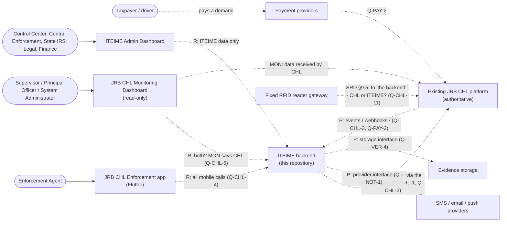

# System context

**Phase 2: architecture proposal, awaiting review.** This document describes
the systems around the ITEIME backend, who uses them, and how information
flows between them.

## How to read the labels

The same labels are used in every Phase 2 document:

| Label   | Meaning                                                                                                     |
| ------- | ----------------------------------------------------------------------------------------------------------- |
| **[C]** | **Confirmed**: stated in a primary source (SRD, ITEIME, MON), with a citation                               |
| **[R]** | **Recorded decision**: stated by the project owner or in REQ or the repository, but not in a primary source |
| **[P]** | **Proposal**: an architecture recommendation from this phase that needs approval                            |
| **[Q]** | **Unresolved**: see the linked [open question](../requirements/open-questions.md)                           |

The sources (SRD, ITEIME, MON, REQ, APP) are listed at the top of
[open-questions.md](../requirements/open-questions.md#sources).

## Systems

| System                                | Responsibilities                                                                                                                                                                                                                                                                                   | Label and evidence                                              |
| ------------------------------------- | -------------------------------------------------------------------------------------------------------------------------------------------------------------------------------------------------------------------------------------------------------------------------------------------------- | --------------------------------------------------------------- |
| **Existing JRB CHL platform**         | Authentication and authorization; vendors, Principal Officers and agents; vehicles; RFID/E-Tag records; QR references; CHL trips (creation rules, validity, destination completion); tariffs and levies; payments and transactions. It is the authority for trip status.                           | [C] SRD §1, §3.2, §14, §37 "Central Systems"                    |
| **ITEIME backend** (this repository)  | The Enforcement Engine: case intake and lifecycle, actors, classification, linked cases, tag workflows, intelligence, the suspect register, legal, financial adjustments, central and state workflows, communication and notifications (T1–T15). The mobile API (T17) and platform services (T18). | [C] ITEIME T1–T16; T17 and T18 are author additions [Q] Q-REP-4 |
| **JRB CHL Enforcement app** (Flutter) | Field verification by RFID, QR, plate and OCR; GPS; evidence; violations; demand notices; payment status; offline queue and sync; history; notifications; field reports (SOS, vehicle, driver and situation reports, loaded/empty).                                                                | [C] SRD §2, §3.1. Code in `jbr_chl_enforcement/`                |
| **ITEIME Admin Dashboard**            | The operational interface for ITEIME workflows: Control Center, case management, Central Enforcement (T12) and State IRS (T13) views, legal, finance and collaboration.                                                                                                                            | [C] ITEIME. Not built yet                                       |
| **JRB CHL Monitoring Dashboard**      | Read-only monitoring: verification, trips, violations, evidence, payments, repeat vehicles, field reports, sync status and audit, all within the user's geographic scope.                                                                                                                          | [C] MON. Not built yet                                          |
| Payment providers                     | QR, USSD, bank transfer, generated account, POS/card, or the existing CHL payment platform.                                                                                                                                                                                                        | [C] SRD §23.1; the provider is unknown [Q] Q-PAY-2              |
| SMS, email and push providers         | Taxpayer SMS confirmations, escalation alerts, and push notifications to agents.                                                                                                                                                                                                                   | [C] ITEIME T1.5, T15; SRD §29. Unknown [Q] Q-NOT-1              |
| Evidence storage                      | Photographs and other files.                                                                                                                                                                                                                                                                       | [C] SRD §24. Undefined [Q] Q-VER-4                              |
| Fixed RFID reader gateway             | Fixed reader → WebSocket gateway → backend → app.                                                                                                                                                                                                                                                  | [C] SRD §9.5. The owner is unknown [Q] Q-CHL-11                 |
| EDMS, CCA, MVLAs, other systems       | Named as integrations; their contents are undefined.                                                                                                                                                                                                                                               | [C] SRD §3.1; ITEIME T10. [Q] Q-CHL-12, Q-CAS-8                 |

## Actors

| Actor                                                          | Uses                                              | Evidence                                            |
| -------------------------------------------------------------- | ------------------------------------------------- | --------------------------------------------------- |
| Enforcement Agent                                              | Mobile app                                        | [C] SRD §4.1                                        |
| Supervisor                                                     | Mobile app (SRD §7.2) and/or Monitoring Dashboard | [C] SRD §4.3, MON §1; where: [Q] Q-ROL-9            |
| Principal Officer                                              | Monitoring Dashboard; violation closure           | [C] MON §1, SRD §22; no role definition [Q] Q-REP-5 |
| System Administrator                                           | Monitoring Dashboard (complete audit trail)       | [C] SRD §4.4, MON §12                               |
| Call-centre / Control Center operator                          | Admin Dashboard (call intake)                     | [C] ITEIME T1 (the role isn't named) [Q] Q-ROL-1    |
| Central Enforcement team                                       | Admin Dashboard (T12)                             | [C] ITEIME T12                                      |
| State IRS staff                                                | Admin Dashboard (T13)                             | [C] ITEIME T13                                      |
| Legal team                                                     | Admin Dashboard (T9)                              | [C] ITEIME T9; "should be added" [Q] Q-ROL-6        |
| Finance unit                                                   | Admin Dashboard / notifications (T11.3)           | [C] ITEIME T11                                      |
| Support agents                                                 | Tag issue reporting (T6.5)                        | [C] ITEIME T6.5                                     |
| Taxpayer / driver                                              | Receives SMS, pays demands, queries case status   | [C] ITEIME T1.5, T15.5; SRD §23                     |
| Case actors: IRS, Police, Enforcement Agents, Civilian/Unknown | Recorded _in_ cases; they don't use the system    | [C] ITEIME T3.1                                     |

## Context diagram

Solid arrows are flows stated in a source document. Dashed arrows are recorded
decisions or proposals, still to be confirmed.

The reader-gateway flow itself is confirmed by SRD §9.5 ("Fixed RFID Reader →
WebSocket Gateway/Service → Backend → Mobile Application"). Its destination is
not: "Backend" there could mean CHL or ITEIME (Q-CHL-11), so the arrow is
dashed.

## Information flows

| #   | Flow                                                                                                                                | Label                                                          |
| --- | ----------------------------------------------------------------------------------------------------------------------------------- | -------------------------------------------------------------- |
| F1  | Agent sign-in uses existing CHL credentials; 24-hour session; access is denied at once when the account is deactivated              | [C] SRD §5. Route and token issuer [Q] Q-CHL-2, Q-CHL-4        |
| F2  | Every verification method resolves to one backend verification service: vehicle → E-Tag → trip → result                             | [C] SRD §8. Who computes it [Q] Q-CHL-6                        |
| F3  | Every verification attempt is recorded with GPS and the §28 audit fields                                                            | [C] SRD §25, §28. Where it is stored [Q] Q-CHL-7               |
| F4  | Violation, evidence and demand notice are sent from the app; levy plus penalty is calculated by "the backend"                       | [C] SRD §20, §23. Which backend [Q] Q-PAY-1, Q-CHL-7           |
| F5  | Payment confirmation → trip activation or tagging process (CHL actions); "payment received" stays distinct from "trip activated"    | [C] SRD §23.2, MON §10. How ITEIME learns [Q] Q-PAY-2, Q-PAY-3 |
| F6  | Offline actions are queued, then synchronized with idempotency                                                                      | [C] SRD §26, §33.2. Rules [Q] Q-SYN-2                          |
| F7  | Field reports and notifications go from the app to the backend (SOS, vehicle/driver/situation reports, notify system, loaded/empty) | [C] SRD §2 (item 17)                                           |
| F8  | Repeat-vehicle alert after three qualifying reports → central or supervisory process → push and in-app notification                 | [C] SRD §29. Criteria [Q] Q-SYN-3                              |
| F9  | Call intake → case → assignment → investigation → … → closure / escalation, with SMS to the taxpayer                                | [C] ITEIME T1, T2. Lifecycle [Q] Q-CAS-1                       |
| F10 | An escalated case reaches Legal, the Central Enforcement team, and finance adjustments                                              | [C] ITEIME T9, T11, T12                                        |
| F11 | Monitoring reads verification, violation, payment, field-report, sync and audit records, filtered by role and scope                 | [C] MON §1–§13. Source [Q] Q-CHL-5                             |

## Recorded decisions that need confirmation

These come from REQ §1.1 and the project owner (14 Oct 2026). They are not in
the primary sources:

- **[R]** The mobile app calls only ITEIME, and ITEIME calls CHL
  server-to-server. This disagrees with SRD §37 (X1, Q-CHL-4).
- **[R]** The ITEIME Admin Dashboard uses only ITEIME's own data. This is in
  tension with T6, T11.4 and T15.5 (X7, Q-CHL-15).
- **[R]** The Monitoring Dashboard reads both ITEIME and CHL. MON says CHL
  (X2, Q-CHL-5).
- **[R] Confirmed by the project owner (14 Oct 2026):** `backend/` is the
  only, main backend; `iteime_backend/` was removed in commit `d3f5652` (Q-REP-1, [ADR-0004](../decisions/0004-single-backend.md)).

## Out of scope for ITEIME

**[C]** These stay in CHL (SRD §3.2; MON "Features not to add"): account,
vendor and Principal Officer creation; vehicle registration; tag issuance and
registration; tariff configuration; trip-creation rules and trip creation;
role and geographic-assignment editing.

**[C]** These are future extensions, not the current scope (SRD §38; MON):
automated vehicle classification, AI-assisted haulage detection, driver
identification, digital impound, advanced geofencing, fraud detection, agent
performance scoring and national analytics.
